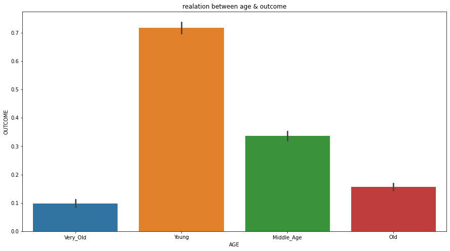
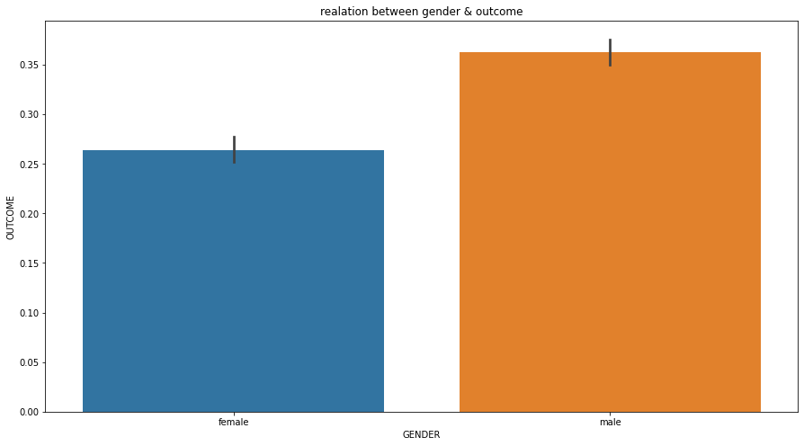
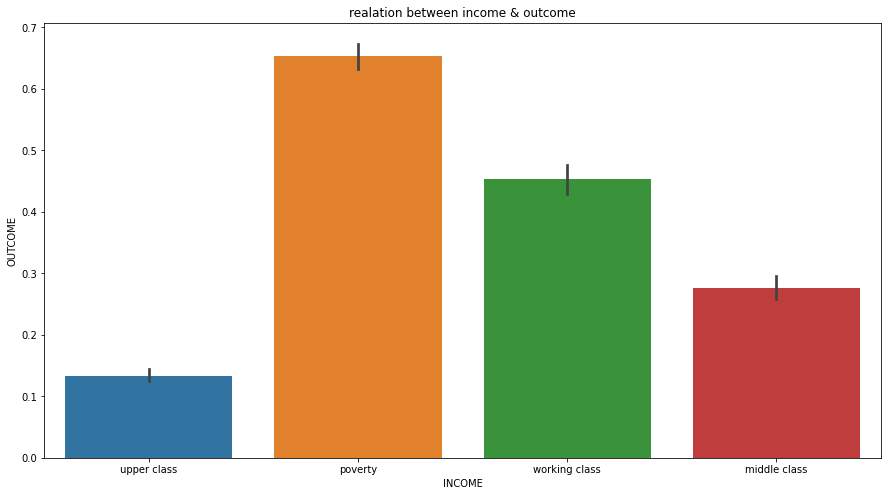
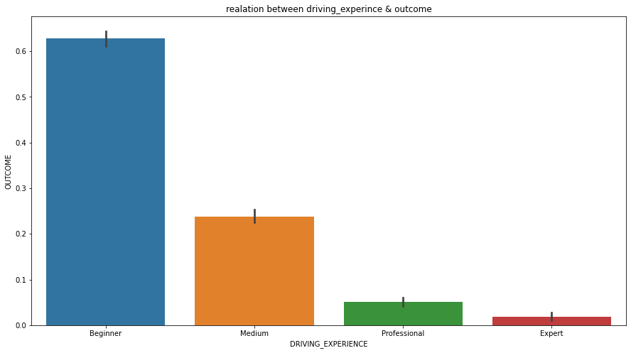
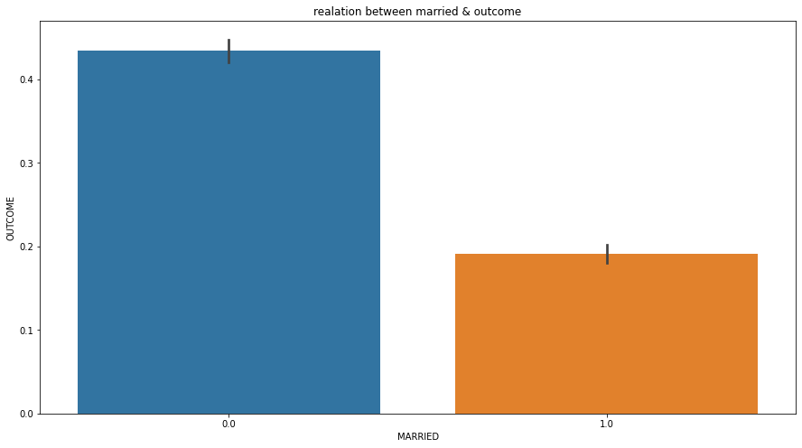

# Car Insurance Claims Analysis

Exploratory data analysis and preprocessing of car insurance data using Python, with a focus on understanding how customer demographics and driving history relate to insurance outcomes.

**Python · Pandas · NumPy · Matplotlib · Seaborn · Scikit-learn**

## Project Overview

This project explores a car insurance dataset containing **10,000 records and 19 columns**. The analysis examines customer attributes, driving experience, income, and other factors in relation to the binary `OUTCOME` variable. The workflow includes data cleaning, categorical encoding, train/test splitting, and feature scaling.

## Analysis Objectives

- Examine insurance outcomes across different age groups.
- Compare outcomes by gender and income category.
- Explore the relationship between driving experience and outcomes.
- Analyze differences by marital status.
- Prepare and transform the dataset for downstream analysis.

## Exploratory Data Analysis

The following visualizations summarize the relationships explored in the notebook. Each bar represents the average value of the binary `OUTCOME` variable within a category.

### Age and Insurance Outcome



The analysis compares four age categories: Young, Middle_Age, Old, and Very_Old.

### Gender and Insurance Outcome



A comparison of average insurance outcomes across gender categories.

### Income and Insurance Outcome



An examination of how the average outcome differs across income groups.

### Driving Experience and Insurance Outcome



A comparison of driving-experience categories, from Beginner through Expert.

### Marital Status and Insurance Outcome



A comparison of the average outcome across marital-status categories.

## Data Preparation

The analysis includes the following data preparation steps:

1. **Data exploration:** Inspect the dataset, data types, summary statistics, and missing values.
2. **Missing-value handling:** Fill missing `CREDIT_SCORE` and `ANNUAL_MILEAGE` values with their respective medians.
3. **Outlier treatment:** Identify and handle outliers in numerical features using `datasist`.
4. **Feature preparation:** Separate input features from the `OUTCOME` target.
5. **Categorical encoding:** Convert categorical predictors into numerical features using one-hot encoding.
6. **Train/test split:** Split the dataset into training and testing subsets.
7. **Feature scaling:** Standardize the feature matrices with `StandardScaler`.

## Dataset

| Attribute | Details |
| --- | --- |
| Records | 10,000 |
| Columns | 19 |
| Target variable | `OUTCOME` |
| Data type | Customer demographics, vehicle information, and driving history |

Selected features include `AGE`, `GENDER`, `INCOME`, `DRIVING_EXPERIENCE`, `CREDIT_SCORE`, `ANNUAL_MILEAGE`, `SPEEDING_VIOLATIONS`, `DUIS`, and `PAST_ACCIDENTS`.

## Technologies

- **Python** — data analysis
- **Pandas & NumPy** — data manipulation and preprocessing
- **Matplotlib & Seaborn** — data visualization
- **datasist** — outlier detection
- **Scikit-learn** — train/test splitting and feature scaling
- **Jupyter Notebook** — interactive analysis

## Repository Structure

```text
├── README.md
├── data/
│   └── Car_Insurance_Claim.csv
├── images/
│   ├── 01-age-vs-outcome.png
│   ├── 02-gender-vs-outcome.png
│   ├── 03-income-vs-outcome.png
│   ├── 04-driving-experience-vs-outcome.png
│   └── 05-marital-status-vs-outcome.png
└── notebooks/
    └── car_insurance.ipynb
```

## Author

**Omar Ali**  
Data Engineering · Analytics Engineering

[LinkedIn](https://www.linkedin.com/in/eng-omargomaa) · [GitHub](https://github.com/omaraligomaa)
